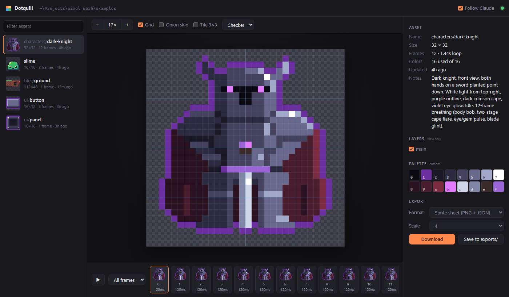
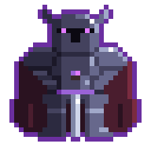
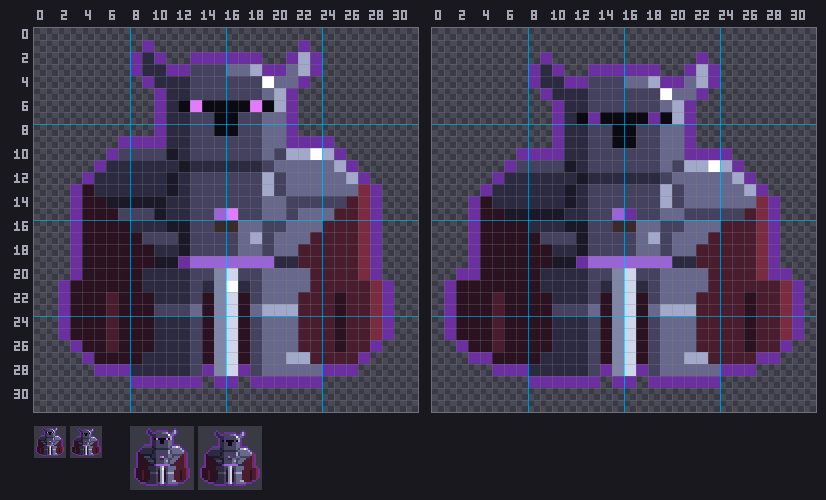
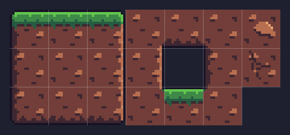
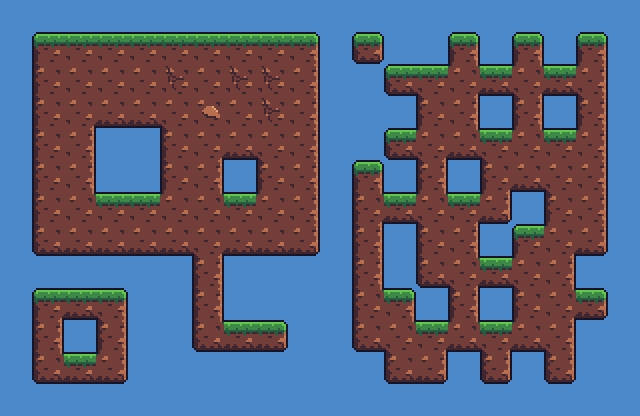
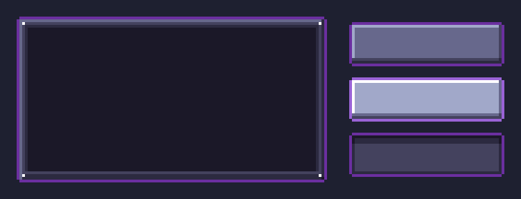

# Dotquill

A local, open-source pixel-art studio that **Claude Code draws in**.

Claude gets drawing tools over [MCP](https://modelcontextprotocol.io): palette-locked pixels, shapes, outlines, mirroring, frames, previews it can look at, and quality checks. You watch the result live in a browser viewer, play animations and export game-ready files. No image model, no GPU, no cloud: Claude places every pixel itself.



## What it makes

Everything here was drawn by Claude through Dotquill's tools. The source files are in [`examples/`](examples); open them with `npm run viewer -- --dir examples --open`.

### Characters and animation



*“A 32×32 dark knight with a single sword, white light from the top-right, purple outline, and a 12-frame idle.”*

Claude blocks in the silhouette, shades with a locked palette, adds the outline and animates frame by frame: breathing, a flaring cape, a glint on the blade. Exports: sprite sheet with Aseprite JSON, GIF, Godot `SpriteFrames`.

While it works, Claude looks at previews like this one: zoomed frames with rulers and a pixel grid, plus actual-size copies to check that the sprite reads at 1×.



### Terrain tilesets with autotiling

Claude draws one template (top): a 3×3 island and a block of ground around a one-tile hole. Dotquill builds all 47 tiles that autotiling needs and paints them on a test map (bottom), so seams show up before export. Godot gets a `TileSet` with the terrain already set up.





### Pixel UI

A panel and a button with normal, hover and pressed states, resized through their 9-slices. Exported as Godot `StyleBoxTexture` resources.



## Why Dotquill

- **No Aseprite or other editor required.** Claude draws directly through Dotquill's own tools. There is nothing else to install, license or keep open.
- **Live viewer.** Every change appears in the browser right away. The viewer follows the asset Claude is working on, plays animations and exports with one click.
- **Strict palette lock.** Every pixel is a palette color: built-in presets or any [Lospec](https://lospec.com/palette-list) palette. No stray off-palette shades, so a whole asset set stays consistent.
- **Claude checks its own work.** `render_preview` returns a zoomed image with coordinate rulers, a pixel grid and actual-size copies. Claude looks at it, fixes mistakes, and runs `audit` for stray pixels, edge contact and animation jitter.
- **Plain-text files that work with git.** Each asset is a readable `*.pixel.json` with pixels stored as text rows, so diffs show what changed. History with undo.
- **No build step.** Node 22.18+ runs the TypeScript sources directly: clone, `npm install`, done.

## Features

- **Drawing**: pixel rows, lines, rectangles, ellipses, flood fill, color replace, outlines, mirroring, flip, shift, copy/move regions, dithering, repeating patterns, and `onlyOn` masks for shading inside a shape.
- **Animation**: frames, durations, tags (idle, walk…), playback and onion skin in the viewer.
- **Layers**: add, reorder, hide, merge.
- **Terrain tilesets with autotiling**: draw a 7×3-tile template (an island and a ring around a hole), get all 47 "blob" tiles an engine needs; a test-map preview shows seams before you export.
- **Pixel UI (9-slice)**: panels, buttons and bars with fixed corners and stretching or tiling edges; button states as frames; resize check in the preview.
- **Exports**: PNG, PNG per frame, sprite sheet + Aseprite-compatible JSON with tags and slices (Phaser, PixiJS, Godot and other importers), animated GIF, editable `.aseprite` (layers, tags, slices), Godot `SpriteFrames` (one animation per tag), `TileSet` (terrain autotiling, optional collision) and `StyleBoxTexture` for 9-slice UI. Integer upscaling.
- **Touch-ups in the viewer**: pencil, eraser, eyedropper and undo, for the pixel you want changed right now.
- **Import**: PNG to asset, with palette quantization, sheet slicing and downscaling of upscaled art.

## Requirements

Node.js **22.18+**.

```sh
git clone https://github.com/XblissDen/Dotquill.git dotquill
cd dotquill
npm install
```

## Connect to Claude Code

**Inside this repo:** `.mcp.json` is already here. Start `claude` in this folder and approve the `dotquill` server.

**In your game project (recommended):** register it once for all projects:

```sh
claude mcp add dotquill --scope user -- node /absolute/path/to/dotquill/src/mcp/server.ts
```

Assets are then stored in `<your project>/dotquill-art/`. To use a different folder, add `-e DOTQUILL_DIR=/path/to/folder` (before `--`). A workspace in `pixel-art/`, the older default, keeps working until you rename it.

Other MCP clients (Claude Desktop, Cursor, …) work the same way: command `node`, args `["/absolute/path/to/dotquill/src/mcp/server.ts"]`.

## Use it

Just ask, for example:

- “Draw a 16×16 green slime with a 2-frame idle bounce, sweetie-16 palette.”
- “Make a 32×32 knight, side view, light from the top-left, dark outline. Then a 4-frame walk cycle.”
- “Make a 16×16 grass tileset with autotiling and export it for Godot into `tiles/`.”
- “Export the knight as a sprite sheet at 4× into `assets/sprites`.”
- “Open the viewer.”

The viewer starts automatically on the first tool call at <http://127.0.0.1:7420/> (the next free port if 7420 is busy). It follows the asset Claude is working on; turn off “Follow Claude” to browse on your own.

Without Claude running:

```sh
npm run viewer -- --dir /path/to/dotquill-art --open
```

Viewer keys: `←`/`→` frames, `space` play, `+`/`-`/`0` zoom/fit, `g` grid, `o` onion skin, `t` tile 3×3, `s` 9-slice guides, `m` test map (tilesets). Hover a palette swatch to highlight its pixels.

Touch-ups: `p` pencil, `e` eraser, `v` back to view only. Click a palette swatch to pick the color, or `Alt`+click the canvas. The pencil paints on the layer marked ● in the Layers panel. Each stroke is saved right away as one undo step; `Ctrl+Z` undoes the last saved change, yours or Claude's.

## Tools

| Tool | What it does |
|---|---|
| `guide` | Pixel-art workflow and techniques (sprites, shading, outlines, animation, tiles, palettes, UI). |
| `create_asset` | New canvas with a palette, layers and frames; returns the palette legend. `tileset` makes a blob autotile template or a grid of tiles. |
| `get_asset` | Pixel rows with x/y rulers, palette legend, frames and tags. |
| `write_pixels` | Write rows of palette characters at (x, y); `.` transparent, `_` keep. |
| `draw` | Ops: pixel, line, rect, ellipse, fill, replace, outline (with `refresh` to rebuild after moving parts), mirror, flip, shift, clear, copy, dither, pattern (+ `onlyOn` masks). One frame, a list of `frames`, or `allFrames`. |
| `render_preview` | Image for Claude to inspect: zoom, rulers, grid, 1×/2× copies, 9-slice guides, `tile` mode, `diff` mode (marks pixels changed since the previous frame), `stretch` mode (resizes UI through its 9-slice), `tilemap` mode (paints a tileset onto a test map). |
| `palette` | Presets, switch palette (nearest or index remap), edit or add colors. |
| `frames` | Add/copy, delete, move frames, durations, tags. |
| `layers` | Add, delete, rename, move, show/hide, merge down. |
| `slices` | Named regions; with `nine` margins a 9-slice for UI (`stretch` or `tile`). |
| `audit` | Stray pixels, suspicious lone pixels (deliberate highlights are told apart), edge contact, empty frames, animation jitter, color usage. |
| `export` | `png`, `frames`, `sheet` (+ JSON), `gif`, `aseprite`, `godot-spriteframes` (sheet + `SpriteFrames` `.tres`, one animation per tag), `godot-tileset` (atlas + `TileSet` `.tres` with terrain, optional collision), `godot-stylebox` (PNG + `StyleBoxTexture` `.tres` per state); scale; optional `outDir`. |
| `import_png` | PNG → asset: keep colors or quantize to a palette, slice sheets, downscale upscaled art. |
| `manage_asset` | Duplicate, rename, delete (to trash), undo, edit notes, set or remove tileset settings. |
| `open_viewer` | Open the live viewer in the browser. |

## Godot

Ask Claude to export into a folder inside your Godot project (for example `outDir: "C:/Games/my-game/art"`); texture paths are then written as `res://…`. Outside a project the `.tres` files reference the PNG by a relative path, so keep them next to it.

For crisp pixels set **Project Settings → Rendering → Textures → Default Texture Filter = Nearest** and use integer scaling (**Display → Window → Stretch → Scale Mode = integer**).

### Animated sprites

`godot-spriteframes` writes `hero_sheet@4x.png` and `hero_frames@4x.tres`, a `SpriteFrames` resource with one animation per tag (idle, walk, …). Per-frame durations are kept: the animation speed is set from the shortest frame, and longer frames get a larger relative duration. Tag directions `reverse` and `pingpong` are unrolled into the frame order. Assign the `.tres` to **AnimatedSprite2D → Sprite Frames** and call `play("idle")`. Without tags you get one `default` animation over all frames.

### Terrain tilesets

Ask for something like “a 16×16 grass tileset with autotiling, export it for Godot into `tiles/`”. Claude creates a blob template (7×3 tiles: a 3×3 island with outer corners, edges and center, solid ground around a one-tile hole for the inner corners, and up to three center variants), draws it, checks the 47 generated tiles on a test map with `render_preview` `tilemap`, and exports with `godot-tileset`:

- `grass_tiles.png` holds the 47 tiles (plus variants), and `grass_tileset.tres` is a `TileSet` with the terrain `grass` already set up (Match Corners and Sides).
- Add a **TileMapLayer**, set **Tile Set** to the `.tres`, open **TileMap → Terrains**, pick `grass` and paint: Godot picks the right tile for every cell. Center variants are mixed in at random.
- `collision: true` adds full-tile collision on physics layer 0 for platformer ground and walls.
- A `grid` tileset (props, decorations) exports every non-empty cell as a plain tile.

### Pixel UI

Ask for something like “a 16×16 stone panel and a button with normal/hover/pressed states, 9-slice, export for Godot into `ui/`”. Claude draws them, sets the 9-slice margins, checks the resizing with `render_preview` `stretch`, and exports with `godot-stylebox`:

- `button_sheet@4x.png` holds all the states, and `button_normal@4x.tres`, `button_hover@4x.tres`, `button_pressed@4x.tres` are `StyleBoxTexture` resources with the margins already set.
- Assign them in the Inspector (`theme_override_styles/normal`, `hover`, `pressed` on a `Button`, `panel` on a `Panel`) or put them in a `Theme`.

## Files

```
dotquill-art/               workspace (DOTQUILL_DIR)
  slime.pixel.json          one asset; folders allowed: characters/hero.pixel.json
  exports/                  default export folder
  .dotquill/                history (undo), trash, viewer focus; git-ignored automatically
```

A `.pixel.json` stores the palette as hex colors and each layer of each frame as text rows. Character `n` of `0-9a-zA-Z…` is palette index `n`, and `.` is transparent.

## Configuration

| Variable | Default | |
|---|---|---|
| `DOTQUILL_DIR` | `./dotquill-art` | Workspace folder (also `--dir`). |
| `DOTQUILL_PORT` | `7420` | First viewer port to try. |
| `DOTQUILL_NO_VIEWER` | | `1` disables the viewer. |

## Development

```sh
npm run typecheck   # tsc --noEmit
npm test            # unit tests (node:test)
npm run smoke       # drives the real MCP server through an MCP client; writes previews
npm run docs        # renders the README images in docs/ from examples/
```

Roadmap ideas: Tiled exports, animated tiles, palette ramp tools, optional local diffusion backend (ComfyUI) with palette quantization.

## License

The code is [MIT](LICENSE). The art you make with Dotquill is yours. The example assets in `examples/` fall under the same MIT license, so use them however you like.
